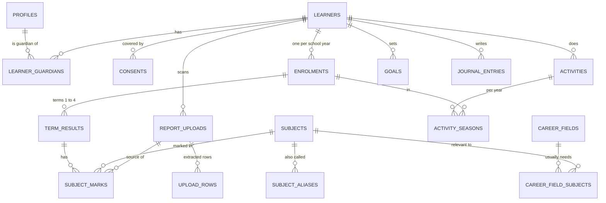

# My High School Journal: data model (v0.1 draft)

Postgres on Supabase. The schema is in `db/schema.sql` and the reference data in `db/seed.sql`.

## The idea in one paragraph

A **learner** has one **enrolment** per school year, each enrolment has up to four **term results**, and each term result has one **mark per subject**. Marks arrive either by typing them in or by scanning a report card. A scan never writes marks directly: it creates **upload rows** that the learner or parent confirms first. Everything the charts show (averages, strengths, trends, patterns) is calculated from confirmed marks by **views**, so nothing is stored twice and nothing goes stale.

## Entity map



## Tables at a glance

| Group | Tables | Purpose |
|---|---|---|
| People and access | `profiles`, `learners`, `learner_guardians`, `consents` | Who signs in, whose record it is, who may see it, and recorded POPIA consent |
| Reference data | `subjects`, `subject_aliases`, `career_fields`, `career_field_subjects` | Maintained by us. Aliases map "Maths" or "Wiskunde" on a report to one subject |
| Marks | `enrolments`, `term_results`, `subject_marks` | The core story data |
| Scanning | `report_uploads`, `upload_rows` | Upload, extract, review, confirm |
| Extras | `activities`, `activity_seasons`, `goals`, `journal_entries` | Extramural bars, the goal line, private notes |
| Insights | views `term_averages`, `subject_term_marks` | Calculated, never stored |

## Decisions worth knowing about

1. **Scans are staged.** Extracted rows live in `upload_rows` until confirmed, then `confirm_upload()` copies them into `subject_marks` in one transaction. Unconfirmed OCR never reaches a chart, and a flagged row (`needs_check`) blocks confirmation until someone looks at it. This is the "scan and confirm" screen.
2. **Same-learner integrity is enforced by the database.** Child tables carry `learner_id` and use composite foreign keys such as `(enrolment_id, learner_id)`. A mark cannot point at another learner's term, and row level security stays simple because every table has `learner_id`.
3. **Grade and year are separate.** `enrolments` has `grade` (0 is Grade R) and `calendar_year`, unique per learner per year, so a repeated grade works. `phase` (primary or high) is generated from the grade.
4. **The model starts with Grade R to 12, not just high school.** This matches the primary to high school story, and primary reports sometimes show achievement levels (1 to 7) instead of percentages, so both columns exist and at least one must be filled.
5. **Insights are views.** `term_averages` powers the journey map and the term bars. `subject_term_marks` gives each mark with its change since the previous term, which is how "Term 3 dipped in Grades 8 and 9" is found.
6. **Extramurals are seasons.** An activity (Hockey) has seasons (Grade 9 Term 2 to Grade 10 Term 4), which is exactly what the bars under the chart draw.
7. **Sharing rules.** Guardians always see marks and trends. They see extramurals unless the learner turns `share_extramurals` off. They see a journal entry only if the learner marked it shared. This is the answer to "struggling learners may not want to share"; it needs a product decision (below) on whether marks should ever be hideable.
8. **Data minimisation.** Learners have a first name only: no surname, ID number or birth date. Scan images go to a private bucket and are marked for deletion 30 days after confirmation (`delete_after`).
9. **Erasure.** Deleting a learner cascades to every table above. A scheduled job must also delete the image files in storage for those paths.

## The scan flow

```
uploaded -> processing -> needs_review -> confirmed
                 |             |
                 v             v
               failed       discarded
```

1. App uploads the image to `report-scans/<learner_id>/<upload_id>.<ext>` and inserts a `report_uploads` row.
2. An Edge Function reads the image, writes `raw_extraction`, inserts `upload_rows` (matching names through `subject_aliases`) and sets `status = 'needs_review'`.
3. The learner or parent fixes flagged rows, picks the grade and term, and the app calls `confirm_upload(upload_id)`.
4. Marks appear in the charts. The image is deleted after the retention period.

## How the screens map to queries

**Journey map, year averages and latest term**

```sql
select calendar_year, grade, term, average_percent
from term_averages
where learner_id = :learner
order by calendar_year, term;
```

**Subject story, one subject and an optional year filter**

```sql
select calendar_year, grade, term, mark_percent, change_since_previous_term
from subject_term_marks
where learner_id = :learner
  and subject_id = :subject
  and (:year is null or calendar_year = :year)   -- the All years / Grade 8 / 9 / 10 filter
order by calendar_year, term;
```

**Pattern: terms where a subject dropped**

```sql
select calendar_year, grade, term, change_since_previous_term
from subject_term_marks
where learner_id = :learner and subject_id = :subject
  and term = 3 and change_since_previous_term < 0;
```

**My story, strongest and focus subjects for a term**

```sql
select subject_name, mark_percent
from subject_term_marks
where learner_id = :learner and calendar_year = :year and term = :term
order by mark_percent desc;
```

Extramural bars come from `activity_seasons` joined to `activities` and `enrolments`. The goal line comes from `goals`. Career cards compare a learner's marks with `career_field_subjects`.

## Security

Row level security is on for every table. A learner sees their own data and a guardian sees what the rules in decision 7 allow. Reference data is read-only for signed-in users. The scan bucket policies read the learner from the first folder of the object path.

One trap worth remembering: in Postgres a `for all` policy also grants SELECT, and permissive policies are OR-ed together. Where read access is narrower than write access (extramurals and the journal), write policies are written per command (`insert`, `update`, `delete`) so they cannot widen who can read.

## Testing

`db/tests/` loads the schema and seed into a plain Postgres with small stand-ins for Supabase's `auth` and `storage` schemas, then checks:

- a creating parent becomes a guardian automatically, and unrelated parents see nothing (tables and views)
- a mark cannot attach to another learner's term result, and writes to another learner's data are blocked
- a learner login cannot create learners
- guardians see only journal entries marked shared, and cannot write the journal
- extramurals are visible to guardians by default and hidden when the learner turns sharing off, while marks stay visible
- term averages and change-since-previous-term are calculated correctly
- the scan flow: alias matching, a flagged row blocks confirmation, duplicate subjects give a clear error, confirming saves marks with provenance and a retention date, confirming twice does not duplicate
- scan storage is readable and writable only by that learner's own people
- deleting a learner removes every related row and leaves other learners untouched

These tests ran against Postgres 16. They have not been run against a real Supabase project yet, so storage and auth behaviour there still needs a check once a project exists.

## Open questions for you

1. **Should marks ever be hideable from a parent?** The current rule is no: parents always see marks, learners control the rest. The alternative is a per-term "share with parent" switch.
2. **Does Life Orientation count toward the average?** The mock-ups include it. Universities exclude it from admission scores, so we may want two averages. The flag is `subjects.counts_toward_average`.
3. **Term mark versus year mark.** Term 4 reports often show a year mark too. The model stores one mark per subject per term for now.
4. **Do learners get their own login from the start?** The schema allows it (`learners.user_id`), but the invite flow is not designed yet.
5. **Schools table.** Skipped for now (`enrolments.school_name` is free text). If we want to learn each school's report layout to improve scanning, a `schools` table is the next addition.
6. **Subject coverage.** The seed list is a starting point. Real reports will show gaps (other home languages, technical subjects).

## Not covered yet

Career fit scoring (a function over marks and `career_field_subjects`), the invite flow for second guardians, notifications, and payments or subscriptions.
