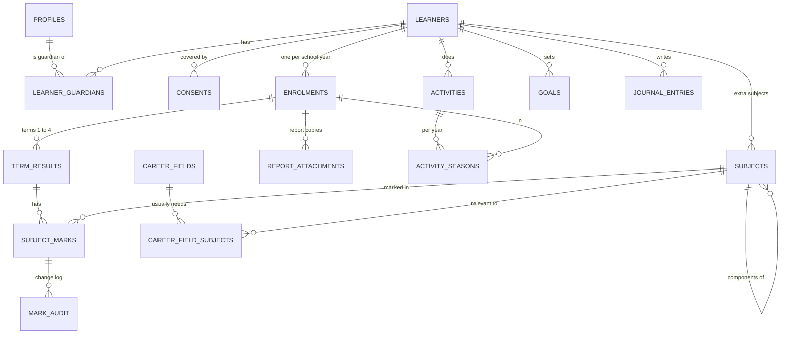

# My School Journey: data model (v0.2 draft)

Postgres on Supabase. The schema is `supabase/migrations/20261125000000_schema.sql`, the CAPS reference data is `20261125000100_caps_seed.sql`, and the sign-up trigger is `20261125000200_signup_profile.sql`.

## The idea in one paragraph

A **learner** has one **enrolment** per school year, each enrolment has up to four **term results**, and each term result has one **mark per subject**. Marks are typed in by the learner or a guardian. A copy of the report card can be attached for record keeping, but nothing reads it. Everything the charts show (averages, strengths, trends, patterns) is calculated from the marks by **views**, so nothing is stored twice and nothing goes stale.

## What changed in v0.2

| Decision | How it is built |
|---|---|
| A learner cannot hide marks from a guardian | No visibility setting exists on marks. A learner can add and correct marks but cannot delete marks, terms, years, report copies or guardians. Every change is logged in `mark_audit`, which guardians can read and nobody can edit |
| Life Orientation counts, plus an average without it | `term_averages` and `year_averages` return `average_percent` (everything) and `average_excluding_lo` |
| Extra subjects | A family can add a subject for one learner (`subjects.created_for_learner`). It counts in the average unless they switch that off. There is no limit on subjects per term |
| Entire CAPS curriculum | 121 standard subjects across all four phases. See "CAPS coverage" below |
| No report card reading for now | The scan staging tables are gone. `report_attachments` stores a copy (PDF or image, 10 MB) for record keeping |

## Entity map



## Tables at a glance

| Group | Tables | Purpose |
|---|---|---|
| People and access | `profiles`, `learners`, `learner_guardians`, `consents` | Who signs in, whose record it is, who may see it, and recorded POPIA consent |
| Reference data | `subjects`, `subject_aliases`, `career_fields`, `career_field_subjects` | Maintained by us (plus each learner's extra subjects) |
| Marks | `enrolments`, `term_results`, `subject_marks`, `mark_audit` | The core story data and its change log |
| Records | `report_attachments` | Report card copies, kept for the family |
| Extras | `activities`, `activity_seasons`, `goals`, `journal_entries` | Extramural bars, the goal line, private notes |
| Insights | views `counted_marks`, `term_averages`, `year_averages`, `subject_term_marks` | Calculated, never stored |

## Decisions worth knowing about

1. **Same-learner integrity is enforced by the database.** Child tables carry `learner_id` and use composite foreign keys such as `(enrolment_id, learner_id)`. A mark cannot point at another learner's term, and row level security stays simple because every table has `learner_id`. An extra subject cannot be used for any other learner (a trigger checks it).
2. **Grade and year are separate.** `enrolments` has `grade` (0 is Grade R) and `calendar_year`, unique per learner per year, so a repeated grade works. `phase` (foundation, intermediate, senior, fet) and `school_level` (primary or high) are generated from the grade.
3. **Both percentages and achievement levels.** Primary reports often show levels 1 to 7 instead of percentages, so both columns exist and at least one must be filled. Averages use percentages only.
4. **Averages.** `average_percent` counts every subject that has a percentage, including Life Orientation. `average_excluding_lo` leaves Life Orientation out. A year average is the mean of the term averages recorded so far, not of every mark.
5. **Components never count twice.** History and Geography sit under Social Sciences, the Life Skills parts under Life Skills, and the four art forms under Creative Arts. If a term has a mark for the umbrella subject, its components are left out of the averages. If it has only the components (a common report layout), they count on their own.
6. **Extra subjects.** `subjects.created_for_learner` marks a subject as belonging to one learner. Only that learner's people can see or change it. It counts in the average by default and can opt out through `counts_toward_average`. An extra subject that still has marks cannot be deleted, so deleting it cannot hide marks.
7. **Extramurals are seasons.** An activity (Hockey) has seasons (Grade 9 Term 2 to Grade 10 Term 4), which is exactly what the bars under the chart draw.
8. **Sharing rules.** Guardians always see marks and trends. They see extramurals unless the learner turns `share_extramurals` off, and a journal entry only if the learner marked it shared.
9. **Learner corrections.** A learner can correct a mark they mistyped. The old and new values and who changed it are recorded and visible to guardians.
10. **Data minimisation.** Learners have a first name only: no surname, ID number or birth date. Report copies live in a private bucket with a 10 MB limit and PDF and image types only.
11. **Erasure.** Deleting a learner cascades to every table above, including extra subjects and the change log. Files in storage must be removed through the Storage API, which the app or a scheduled job has to do for that learner's folder.

## CAPS coverage

Built from the DBE National Policy on Programme and Promotion Requirements (Grades R to 12), the Grade 10 to 12 CAPS subject list, and the NSC subject groupings.

| Phase | Subjects in the seed |
|---|---|
| Foundation (R to 3) | Home Language (R to 3), First Additional Language (from Grade 1), Mathematics, Life Skills with Beginning Knowledge, Creative Arts, Physical Education, Personal and Social Wellbeing |
| Intermediate (4 to 6) | Languages at three levels, Mathematics, Natural Sciences and Technology, Social Sciences (History and Geography), Life Skills |
| Senior (7 to 9) | Languages, Mathematics, Natural Sciences, Technology, Social Sciences, Economic and Management Sciences, Creative Arts (Dance, Drama, Music, Visual Arts), Life Orientation |
| FET (10 to 12) | Mathematics, Mathematical Literacy, Technical Mathematics, Physical Sciences, Technical Sciences, Life Sciences, Accounting, Business Studies, Economics, Consumer Studies, Hospitality Studies, Tourism, Geography, History, Religion Studies, three Agriculture subjects, Computer Applications Technology, Information Technology, Engineering Graphics and Design, the nine Civil, Electrical and Mechanical Technology specialisations, Dance Studies, Design, Dramatic Arts, Visual Arts, three Music streams, Life Orientation, and the other approved NSC subjects (Equine Studies, Marine Sciences, Maritime Economics, Nautical Science, Sport and Exercise Science) |
| Languages | The 11 official languages at Home, First Additional and Second Additional level (33 rows), South African Sign Language Home Language, and 29 non-official language offerings (German, Mandarin, Serbian, Arabic, French, Gujarati, Hebrew, Hindi, Italian, Latin, Modern Greek, Portuguese, Spanish, Tamil, Telugu, Urdu) |

`min_grade` and `max_grade` are typical ranges used to suggest subjects. They are not enforced, because schools differ.

**Left out on purpose** because they are not final CAPS yet or have no published grade or level: Coding and Robotics (draft, being piloted), Kiswahili (optional, phased in from 2025), Khoi, Nama and San (newly announced), occupational subjects, and Sign Language at First and Second Additional level. Families can add any of these as an extra subject today, and we can add them to the standard list when they are final.

## How the screens map to queries

**Journey map: year averages**

```sql
select calendar_year, grade, average_percent, average_excluding_lo, terms_recorded
from year_averages
where learner_id = :learner
order by calendar_year;
```

**My story: term bars for one year (the Grade filter)**

```sql
select term, average_percent, average_excluding_lo
from term_averages
where learner_id = :learner and calendar_year = :year   -- omit the year for All years
order by calendar_year, term;
```

**Subject story: one subject, optional year filter**

```sql
select calendar_year, grade, term, mark_percent, change_since_previous_term
from subject_term_marks
where learner_id = :learner
  and subject_id = :subject
  and (:year is null or calendar_year = :year)
order by calendar_year, term;
```

**Pattern: terms where a subject dropped**

```sql
select calendar_year, grade, term, change_since_previous_term
from subject_term_marks
where learner_id = :learner and subject_id = :subject
  and term = 3 and change_since_previous_term < 0;
```

**My story: strongest and focus subjects for a term**

```sql
select subject_name, mark_percent
from subject_term_marks
where learner_id = :learner and calendar_year = :year and term = :term
order by mark_percent desc;
```

**Subjects to offer when adding marks for a grade** (standard plus this learner's extras)

```sql
select id, name, short_name, category
from subjects
where :grade between min_grade and max_grade
   or created_for_learner = :learner
order by category, name;
```

Extramural bars come from `activity_seasons` joined to `activities` and `enrolments`. The goal line comes from `goals`. Career cards compare a learner's marks with `career_field_subjects`.

## Security

Row level security is on for every table.

- A learner sees their own data. A guardian sees what decision 8 allows.
- Marks, terms, years and report copies: learner and guardians can read, add and correct. Only guardians can delete.
- Reference data is read-only for signed-in users. Extra subjects are visible only to that learner's people.
- Storage policies read the learner from the first folder of the file path.
- In Postgres a `for all` policy also grants SELECT, and permissive policies are OR-ed together. Where read access is narrower than write access (extramurals, journal), write policies are written per command so they cannot widen who can read.
- Foreign keys from marks and goals to subjects are deferred to commit, so erasing a learner works, and deleting an extra subject that still has marks fails.

## Testing

`db/tests/run.sh` applies every migration to a plain Postgres, with small stand-ins for Supabase's `auth` and `storage` schemas, then runs `db/tests/10_rls_and_marks.sql`. It checks:

- the seed: every official language and level, every Grade 10 to 12 subject on the DBE list, every phase subject, one Life Orientation, components overlap their umbrella's grades
- sign-up creates a profile, and an unknown role falls back to parent
- both averages, year averages, term-on-term change, components counted once, extra subjects counting and opting out
- an extra subject cannot be created as a standard one, duplicated, or used for another learner
- unrelated parents see nothing, including views, the change log and extra subjects
- a learner cannot create learners, delete marks, terms, years or guardians, or delete an extra subject that has marks; a learner correction is logged and visible to guardians; the log cannot be edited
- journal and extramural sharing rules
- report copies: right folder, PDF or image, 10 MB, readable by the family only
- erasure removes everything for one learner and leaves others untouched

These ran against Postgres 16. They have not been run against a real Supabase project yet.

## Open questions for you

1. **Learner corrections.** A learner can correct a mark and it is logged. The alternative is that corrections need a guardian's approval. Which fits how you want families to use it?
2. **Level-only reports.** Foundation Phase reports often show only achievement levels. Today these are stored but not averaged. Should they map to a percentage range so the journey map has a line for those years?
3. **Term mark versus year mark.** Term 4 reports often show a year mark too. The model stores one mark per subject per term for now.
4. **Learner logins.** The schema allows a learner login (`learners.user_id`) and a parent sets the link. The invite flow is not designed yet.
5. **Schools.** `enrolments.school_name` is free text. A `schools` table would only matter if we later want per-school report layouts.

## Not covered yet

Career fit scoring (a function over marks and `career_field_subjects`), the learner invite flow, notifications, reading report cards automatically, and payments or subscriptions.
